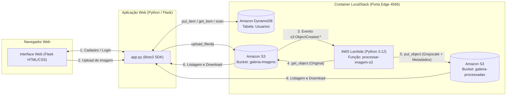

# ☁️ Galeria S3 + DynamoDB + AWS Lambda (LocalStack)

> **Disciplina:** Computação em Nuvem — Simulação de Serviços AWS com LocalStack  
> **Alunos:**
> - **João Pedro Montelo Menezes**
> - **Lucas Jardim**
> - **Luiz Cabral**

---

## 📌 Sobre o Projeto

Este projeto consiste em uma aplicação Web completa desenvolvida em **Python (Flask + Boto3 + Pillow)** integrada ao **LocalStack** (via Docker) para simular localmente uma arquitetura em nuvem da **Amazon Web Services (AWS)** sem custos e sem necessidade de conta real na AWS.

O sistema implementa de forma integrada as **3 Atividades práticas** propostas na disciplina:

1. **Atividade #1 — Armazenamento de Objetos com Amazon S3 (`galeria-imagens`):**
   - Sistema Web para upload de imagens em um bucket S3, listagem com pré-visualização (thumbnail), tamanho em KB, data de modificação e download direto dos objetos.
2. **Atividade #2 — Cadastro e Autenticação de Usuários com Amazon DynamoDB (`Usuarios`):**
   - Sistema de criação de contas e login persistindo dados no banco NoSQL **DynamoDB** (`Partition Key: username`), utilizando hash criptográfico de senhas (`PBKDF2-SHA256` via Werkzeug) e controle de sessão no Flask.
3. **Atividade #3 — Processamento Serverless de Imagens com AWS Lambda (`processar-imagem-s3`):**
   - Função Serverless executada automaticamente por gatilho de evento do S3 (`s3:ObjectCreated:*`). Sempre que uma imagem é enviada ao bucket `galeria-imagens`, a função **AWS Lambda** é acionada, baixa a imagem original, aplica **conversão para Escala de Cinza (Grayscale) + Autocontraste + Moldura Azul** usando a biblioteca **Pillow (PIL)** e salva o resultado com metadados customizados em um segundo bucket S3 (`galeria-processadas`).

---

## 🏗️ Arquitetura da Solução



---

## 🛠️ Tecnologias Utilizadas

| Tecnologia / Serviço | Papel no Projeto |
| :--- | :--- |
| **LocalStack (`3.8` Community)** | Emulador local dos serviços da nuvem AWS rodando em container Docker na porta unificada `4566`. |
| **Amazon S3 (Simple Storage Service)** | Armazenamento de objetos nos buckets `galeria-imagens` (originais) e `galeria-processadas` (saída da Lambda). |
| **Amazon DynamoDB** | Banco de dados NoSQL chave-valor/documentos para persistência e autenticação de usuários na tabela `Usuarios`. |
| **AWS Lambda** | Computação *Serverless* orientada a eventos (`event-driven`) acionada automaticamente por uploads no S3. |
| **Python 3.12 + Flask** | Servidor Web responsável pelas rotas de autenticação, upload, visualização e download. |
| **Boto3 / Botocore** | SDK oficial da AWS para Python, configurado com `endpoint_url="http://localhost:4566"`. |
| **Pillow (PIL)** | Biblioteca de processamento de imagens empacotada junto à função Lambda para transformação visual das imagens. |
| **Docker & Docker Compose** | Orquestração do container do LocalStack e execução isolada dos containers da função Lambda. |

---

## 📂 Estrutura do Repositório

```text
Galeria-S3/
├── .env                  # Variáveis de ambiente do LocalStack (SERVICES=s3,dynamodb,lambda)
├── docker-compose.yml    # Subida do container LocalStack na porta 4566 com acesso ao Docker Socket
├── setup_localstack.py   # Script de provisionamento automático (IaC via Boto3: Buckets S3, Tabela DynamoDB, Lambda e Gatilho S3)
├── lambda_function.py    # Código-fonte da função Serverless AWS Lambda (Atividade #3)
├── app.py                # Aplicação Web Flask integrando S3 (Ativ. #1), DynamoDB (Ativ. #2) e visualização da Lambda (Ativ. #3)
├── requirements.txt      # Dependências Python do projeto (Flask, boto3, Pillow, Werkzeug)
├── RELATORIO.md          # Relatório técnico detalhado e guia completo para a defesa com o professor
└── README.md             # Documentação principal do projeto
```

---

## 🚀 Como Executar o Projeto Passo a Passo

### 1. Subir o LocalStack via Docker Compose

Na raiz do projeto, inicie o container do LocalStack:

```bash
docker compose up -d
```

Verifique se os serviços (`s3`, `dynamodb`, `lambda`) estão disponíveis na porta `4566`:

```bash
curl http://localhost:4566/_localstack/health
```

### 2. Criar o Ambiente Virtual Python e Instalar as Dependências

```bash
python3 -m venv venv
source venv/bin/activate
pip install -r requirements.txt
```

### 3. Provisionar a Infraestrutura no LocalStack (Opcional — Executado Automaticamente pelo `app.py`)

O script `setup_localstack.py` cria os buckets `galeria-imagens` e `galeria-processadas`, a tabela `Usuarios` no DynamoDB, empacota a função `lambda_function.py` com o Pillow em `lambda_function.zip`, faz o deploy da função Lambda `processar-imagem-s3` e registra o gatilho `s3:ObjectCreated:*`:

```bash
python setup_localstack.py
```

### 4. Iniciar a Aplicação Web

```bash
python app.py
```

Acesse no navegador: **[http://localhost:5000](http://localhost:5000)**

---

## 💻 Comandos Úteis via AWS CLI (Inspeção para a Defesa)

Caso deseje inspecionar os recursos diretamente pelo terminal durante a apresentação (apontando para o endpoint `http://localhost:4566`):

```bash
# Listar os buckets S3 criados
aws --endpoint-url=http://localhost:4566 s3 ls

# Listar objetos originais e processados pela Lambda
aws --endpoint-url=http://localhost:4566 s3 ls s3://galeria-imagens
aws --endpoint-url=http://localhost:4566 s3 ls s3://galeria-processadas

# Listar tabelas do DynamoDB e escanear os usuários cadastrados
aws --endpoint-url=http://localhost:4566 dynamodb list-tables
aws --endpoint-url=http://localhost:4566 dynamodb scan --table-name Usuarios

# Listar funções Lambda registradas no LocalStack
aws --endpoint-url=http://localhost:4566 lambda list-functions
```

---

## 📄 Relatório Técnico e Roteiro de Defesa

Para uma explicação aprofundada de cada arquivo, linha de código, arquitetura e perguntas/respostas para a arguição do professor, consulte o arquivo **[RELATORIO.md](./RELATORIO.md)**.
