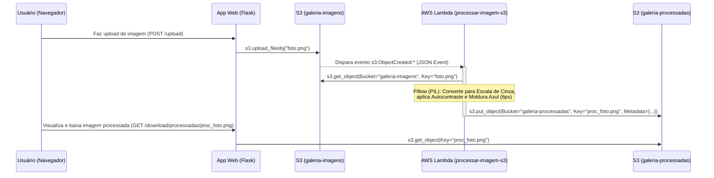

# 📘 Relatório Técnico e Guia de Defesa — Computação em Nuvem com LocalStack

**Disciplina:** Computação em Nuvem  
**Tema:** Simulação Local de Serviços AWS (S3, DynamoDB e Lambda) com LocalStack  
**Alunos Integrantes:**
1. **João Pedro Montelo Menezes**
2. **Lucas Jardim**
3. **Luiz Cabral**

**Repositório Oficial:** `https://github.com/JoaopedroHZN/Galeria-S3`

---

## 1. Introdução e Fundamentação Teórica

O **LocalStack** é uma plataforma que emula serviços da **Amazon Web Services (AWS)** diretamente em ambiente local (via Docker). Com ele, desenvolvedores podem projetar, construir e testar arquiteturas em nuvem completas **sem a necessidade de uma conta real na AWS, sem cartão de crédito e sem custos operacionais**.

### 1.1. Principais Vantagens do LocalStack (Conforme Slides da Aula)
- **Redução de Custos:** Elimina cobranças por armazenamento (S3), requisições de leitura/escrita (DynamoDB) e tempo de computação por milissegundo (Lambda) durante a fase de desenvolvimento.
- **Testes Locais Rápidos e Offline:** Não há latência de rede para data centers remotos (`us-east-1`), acelerando o ciclo de desenvolvimento e depuração.
- **Compatibilidade Oficial (Boto3 e AWS CLI):** O código da aplicação é idêntico ao que rodaria na AWS real — a única alteração necessária é apontar o parâmetro `endpoint_url="http://localhost:4566"`.
- **Segurança e Isolamento:** Nenhum dado sensível ou chave de acesso real sai da máquina local; utiliza-se credenciais fictícias (`aws_access_key_id="test"`, `aws_secret_access_key="test"`).

### 1.2. Comparativo com Alternativas
| Ferramenta | Característica Principal | Diferencial do LocalStack no Projeto |
| :--- | :--- | :--- |
| **LocalStack** | Emula um ecossistema completo da AWS (S3, DynamoDB, Lambda, SQS, etc.) na porta `4566`. | Permite integrar **eventos reais entre múltiplos serviços** (ex.: Upload no S3 acionando automaticamente uma função Lambda). |
| **Moto (Python)** | Biblioteca de *mock* em memória focada em testes unitários Python. | Não executa containers reais de Lambda nem simula infraestrutura multi-linguagem fora do processo Python. |
| **AWS SAM Local** | Focado apenas em API Gateway + AWS Lambda. | Não emula nativamente S3 ou DynamoDB sem ferramentas adicionais. |
| **DynamoDB Local** | Emula exclusivamente o banco NoSQL DynamoDB. | Não oferece suporte a S3 nem funções Serverless Lambda. |

---

## 2. Tudo o Que Foi Utilizado no Projeto (Stack Tecnológica)

1. **Docker & Docker Compose (`docker-compose.yml` e `.env`):**
   - Imagem utilizada: `localstack/localstack:3.8` (*Community Edition* gratuita, que não exige licença Pro nem token de autenticação).
   - **Porta `4566` (Edge Port):** Endpoint unificado que recebe chamadas HTTP de todos os serviços da AWS simulados (`S3`, `DynamoDB`, `Lambda`).
   - **Mapeamento do Docker Socket (`/var/run/docker.sock`):** Essencial para a **Atividade #3**, pois quando a função AWS Lambda é invocada pelo S3, o próprio LocalStack instancia um container Docker isolado com o runtime oficial `python3.12` para executar o código Serverless.
2. **Linguagem e Framework Web (`Python 3.12` + `Flask 3.1.3`):**
   - Responsável pelo servidor HTTP na porta `5000`, gerenciamento de sessões autenticadas (`session`), templates dinâmicos Jinja2 e rotas REST de upload/download.
3. **AWS SDK para Python (`boto3` e `botocore`):**
   - Biblioteca oficial da Amazon para comunicação programática com o S3, DynamoDB e Lambda.
4. **Segurança e Criptografia (`Werkzeug Security`):**
   - Utilizado na **Atividade #2** (`generate_password_hash` e `check_password_hash`) para que as senhas dos usuários nunca sejam salvas em texto puro no DynamoDB, aplicando derivação criptográfica `scrypt`/`PBKDF2`.
5. **Processamento Digital de Imagens (`Pillow / PIL`):**
   - Utilizado na **Atividade #3**, empacotado dentro do arquivo `lambda_function.zip` enviado para a AWS Lambda, permitindo transformar visualmente cada imagem enviada ao S3.

---

## 3. Detalhamento Técnico das 3 Atividades Implementadas

### 3.1. Infraestrutura Automatizada (`setup_localstack.py`)
Para evitar que o desenvolvedor precise criar recursos manualmente toda vez que o container é reiniciado, criamos o módulo [`setup_localstack.py`](./setup_localstack.py), que é executado automaticamente na inicialização do [`app.py`](./app.py). Ele realiza:
1. Criação dos buckets **`galeria-imagens`** (origem) e **`galeria-processadas`** (destino da Lambda) no S3.
2. Criação da tabela **`Usuarios`** no DynamoDB com chave de partição (`HASH`) `username` do tipo String (`S`) e modo de cobrança `PAY_PER_REQUEST` (Serverless On-Demand).
3. Empacotamento automático do arquivo [`lambda_function.py`](./lambda_function.py) junto com os binários da biblioteca `PIL` (Pillow) em um arquivo `lambda_function.zip`.
4. Deploy da função Lambda **`processar-imagem-s3`** (Runtime `python3.12`, Handler `lambda_function.lambda_handler`) e configuração da notificação de eventos (`put_bucket_notification_configuration`) no bucket `galeria-imagens` para o evento **`s3:ObjectCreated:*`**.

---

### 3.2. Atividade #1 — Sistema Web de Upload, Listagem e Download no Amazon S3
> **Requisito da Aula:** *"Utilizando o Amazon S3 (LocalStack) para armazenamento de objetos, implemente em uma linguagem de programação (Web) um sistema de upload/download de arquivos; O seu aplicativo deve fazer upload de imagens para um bucket S3 e depois apresentar a lista e permitir o download."*

**Como foi implementado em [`app.py`](./app.py):**
- **Conexão:** Instanciamos `s3 = boto3.client("s3", endpoint_url="http://localhost:4566", ...)`.
- **Upload (`POST /upload`):** Recebe o arquivo enviado via formulário `multipart/form-data` e utiliza `s3.upload_fileobj(arquivo, "galeria-imagens", arquivo.filename, ExtraArgs={"Metadata": {"enviado-por": username}})` para transmitir o stream diretamente ao bucket S3.
- **Listagem (`GET /`):** Chama `s3.list_objects_v2(Bucket="galeria-imagens")`, extraindo a lista `Contents` com o nome do objeto (`Key`), tamanho em bytes (`Size`) e data (`LastModified`).
- **Visualização e Download (`GET /view/origem/<filename>` e `GET /download/origem/<filename>`):** Utiliza `s3.get_object(Bucket="galeria-imagens", Key=filename)` para ler os bytes do fluxo `obj["Body"].read()` e entregá-los ao navegador via `send_file` do Flask (`as_attachment=False` para exibir a miniatura e `as_attachment=True` para forçar o download).

---

### 3.3. Atividade #2 — Criação de Contas e Autenticação com Amazon DynamoDB
> **Requisito da Aula:** *"Utilizando o DynamoDB (LocalStack) para armazenamento de dados de usuários, implemente em uma linguagem de programação (Web) um sistema de criação de contas e autenticação de usuários; O seu aplicativo deve armazenar os dados no DynamoDB e recuperar os dados de lá para a autenticação."*

**Como foi implementado em [`app.py`](./app.py):**
- **Modelagem NoSQL:** A tabela `Usuarios` no DynamoDB utiliza `username` como **Partition Key (`HASH`)**. Isso permite buscas de complexidade $O(1)$ com latência de milissegundos usando `get_item`.
- **Cadastro de Conta (`POST /cadastro`):**
  1. Recebe `nome`, `username` e `password` do formulário Web.
  2. Verifica se o usuário já existe consultando `tabela.get_item(Key={"username": username})`.
  3. Gera o hash seguro da senha com `generate_password_hash(password)`.
  4. Persiste o documento JSON no DynamoDB usando `tabela.put_item(Item={"username": username, "nome": nome, "password_hash": ..., "criado_em": ...})`.
- **Autenticação (`POST /login`):**
  1. Recupera o registro do usuário diretamente do DynamoDB via `tabela.get_item(Key={"username": username})`.
  2. Compara a senha informada com o hash salvo no banco usando `check_password_hash(item["password_hash"], password)`.
  3. Em caso positivo, autentica a sessão do usuário no Flask (`session["usuario"]`) e libera o acesso à Galeria S3.
- **Transparência Didática:** Na própria tela de login (`/login`), o sistema executa `tabela.scan()` para exibir em uma tabela visual todos os usuários cadastrados no DynamoDB (com seus respectivos hashes de senha truncados), facilitando a comprovação imediata durante a defesa com o professor.

---

### 3.4. Atividade #3 — Função Serverless AWS Lambda Acionada por Upload no S3
> **Requisito da Aula:** *"Utilizando o Lambda (LocalStack) – Funções Serverless, implemente uma função Lambda que é acionada por um upload no S3 e processa a imagem; A sua função pode fazer um upload para outro bucket com o resultado do processamento."*

**Como funciona o fluxo Orientado a Eventos (*Event-Driven*) em [`lambda_function.py`](./lambda_function.py):**

1. **Descoberta de Endpoint Interna na Lambda (`get_s3_client`):**
   - Um detalhe técnico crucial no LocalStack: a aplicação Flask roda na máquina hospedeira e acessa `http://localhost:4566`. Porém, a **função Lambda roda dentro de seu próprio container Docker isolado**. Para que a Lambda alcance o container do LocalStack, utilizamos a variável de ambiente injetada automaticamente pelo runtime do LocalStack (`AWS_ENDPOINT_URL` ou `LOCALSTACK_HOSTNAME`).
2. **Processamento Real da Imagem (`processar_imagem_bytes`):**
   - A função Lambda abre os bytes da imagem original usando `PIL.Image.open()`.
   - Aplica **`ImageOps.grayscale()`** (convertendo a imagem colorida para Preto e Branco / Escala de Cinza).
   - Aplica **`ImageOps.autocontrast()`** para realçar os níveis de brilho.
   - Aplica **`ImageOps.expand(..., border=6, fill="#0066cc")`** adicionando uma moldura azul ao redor da imagem processada.
3. **Gravação no Segundo Bucket com Metadados (`s3.put_object`):**
   - O arquivo processado é salvo no bucket **`galeria-processadas`** com o prefixo `proc_<nome_do_arquivo>` e metadados customizados do S3 (`processado-por: aws-lambda-localstack`, `efeito-aplicado: grayscale-autocontrast-border`, `dimensoes-originais` e `dimensoes-finais`), que são lidos via `s3.head_object` e exibidos na interface Web!

---

## 4. Roteiro Estratégico para a Defesa com o Professor

### 4.1. Sugestão de Divisão da Apresentação entre os 3 Alunos

- **Parte 1 — João Pedro Montelo Menezes (Introdução, Arquitetura LocalStack e Atividade #1 - S3):**
  - Explica o conceito do LocalStack, o arquivo [`docker-compose.yml`](./docker-compose.yml) (destacando a porta unificada `4566`, o arquivo `.env` com `SERVICES=s3,dynamodb,lambda` e por que usamos a tag `localstack:3.8` Community).
  - Demonstra a **Atividade #1**: como o Flask se conecta ao S3 via `boto3` e faz o upload (`upload_fileobj`), listagem (`list_objects_v2`) e download (`get_object`) no bucket `galeria-imagens`.
- **Parte 2 — Lucas Jardim (Atividade #2 - Banco NoSQL Amazon DynamoDB e Autenticação):**
  - Explica as características do Amazon DynamoDB (banco NoSQL Serverless chave-valor/documento de baixa latência).
  - Mostra como a tabela `Usuarios` é criada em [`setup_localstack.py`](./setup_localstack.py) usando `username` como *Partition Key* (`HASH`).
  - Explica as rotas `/cadastro` (`put_item` + hash de senha com Werkzeug) e `/login` (`get_item` + verificação do hash) em [`app.py`](./app.py), mostrando ao vivo a criação de uma conta e o login.
- **Parte 3 — Luiz Cabral (Atividade #3 - Computação Serverless AWS Lambda e Gatilho S3):**
  - Explica o conceito de computação *Serverless* e arquitetura orientada a eventos (*Event-Driven*).
  - Mostra como o bucket `galeria-imagens` foi configurado com `put_bucket_notification_configuration` para disparar o evento `s3:ObjectCreated:*` sempre que chega uma imagem.
  - Explica o código de [`lambda_function.py`](./lambda_function.py): como a Lambda recebe o JSON do evento `Records`, baixa a imagem do primeiro bucket, transforma em escala de cinza com moldura usando Pillow e salva no segundo bucket (`galeria-processadas`) com metadados customizados.

---

### 4.2. Possíveis Perguntas do Professor na Defesa (e Respostas Certeiras!)

1. **Professor: *"O que muda no código de vocês se quiserem migrar hoje do LocalStack para a AWS real em produção?"***
   - **Resposta:** Praticamente nada na lógica de negócio! Como utilizamos o SDK oficial `boto3`, basta remover o parâmetro `endpoint_url="http://localhost:4566"` (ou configurá-lo via variável de ambiente) e fornecer credenciais IAM reais da AWS. Todas as chamadas (`upload_fileobj`, `put_item`, `get_item`, `lambda_handler`) são 100% padrão AWS.

2. **Professor: *"Por que vocês usaram `username` como `KeyType: HASH` na criação da tabela do DynamoDB?"***
   - **Resposta:** No DynamoDB, `HASH` define a **Partition Key (Chave de Partição)**. O DynamoDB usa uma função de hash sobre esse atributo para determinar em qual partição física o item será gravado e buscado. Assim, no momento do login (`/login`), fazemos um `get_item(Key={"username": ...})` que busca o usuário diretamente em tempo constante $O(1)$, sem precisar varrer a tabela inteira.

3. **Professor: *"Qual a diferença entre `get_item` e `scan` que vocês usaram no DynamoDB?"***
   - **Resposta:** O `get_item` busca um único item diretamente pela sua chave primária (`username`), sendo extremamente rápido e econômico. Já o `scan` lê todos os itens da tabela inteira — nós usamos o `scan` apenas para exibir a tabela demonstrativa de usuários cadastrados no rodapé da tela de login.

4. **Professor: *"Como a função Lambda sabe qual arquivo acabou de ser enviado para o S3?"***
   - **Resposta:** Quando configuramos o `put_bucket_notification_configuration` com o evento `s3:ObjectCreated:*`, o próprio S3 invoca a função Lambda passando um dicionário JSON no parâmetro `event`. Dentro de `event["Records"][0]["s3"]`, o S3 envia o nome do bucket (`bucket.name`) e o nome do arquivo (`object.key`). A Lambda lê esses dois campos para buscar o arquivo exato.

5. **Professor: *"Por que dentro do `lambda_function.py` vocês usaram `AWS_ENDPOINT_URL` / `LOCALSTACK_HOSTNAME` em vez de `localhost:4566`?"***
   - **Resposta:** Porque o LocalStack executa a função Lambda dentro de um container Docker separado! Dentro do container da Lambda, `localhost` refere-se ao próprio container da Lambda, e não ao container do LocalStack. O LocalStack injeta automaticamente `AWS_ENDPOINT_URL` apontando para o IP interno da rede Docker onde a porta `4566` está rodando.

6. **Professor: *"A aplicação Flask chama a função Lambda diretamente quando o usuário faz upload?"***
   - **Resposta:** **Não!** Esse é o grande benefício da arquitetura desacoplada (*Event-Driven*). O Flask apenas faz o upload para o bucket `galeria-imagens` no S3 e já responde ao usuário. Quem aciona a função Lambda de forma assíncrona nos bastidores é o próprio serviço Amazon S3 através do gatilho `s3:ObjectCreated:*`.

7. **Professor: *"Por que foi necessário montar `/var/run/docker.sock` no `docker-compose.yml` do LocalStack?"***
   - **Resposta:** Porque o serviço AWS Lambda no LocalStack funciona no modo *Docker Executor*: quando a Lambda é acionada, o LocalStack pede ao daemon do Docker da máquina hospedeira para criar um container com a imagem oficial do runtime AWS Lambda (`python3.12`) para executar o nosso pacote `lambda_function.zip` de forma isolada.
